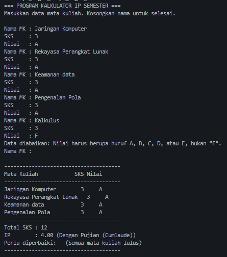

# Tugas Rutin 3: Kalkulator IP Semester (Console)

---

## A. Identitas Mahasiswa

- **Nama** : M. Gali Almahdi
- **NIM** : 4243250042
- **Kelas** : PSIK 24 D 2024

---

## B. Contoh Sesi Interaksi Program

Berikut adalah simulasi eksekusi sesi program di console terminal yang memperlihatkan penanganan kesalahan input sehingga data yang salah diabaikan tanpa menyebabkan program crash:

---

## C. Penjelasan Higher-Order Function dan Error Handling

Pada program ini, higher-order function diterapkan pada fungsi hitungIp() dan cetakKhs(). Di dalam fungsi hitungIp(), method fold digunakan dua kali untuk mengakumulasi total bobot (mk.sks * bobot(mk.nilai)) serta menjumlahkan total SKS secara deklaratif. Pada fungsi cetakKhs(), method sort menerima fungsi pembanding anonim (a, b) => bobot(b.nilai).compareTo(bobot(a.nilai)) untuk mengurutkan mata kuliah dari nilai tertinggi ke terendah, sedangkan method where digunakan untuk menyaring daftar mata kuliah dengan bobot nilai di bawah 2.0 (kategori perlu perbaikan).

Sementara itu, error handling diimplementasikan dengan memisahkan fungsi validasi dan penangkap exception. Fungsi validasiSks() dan bobot() bertugas memvalidasi nilai input dan melempar FormatException jika masukan tidak memenuhi kriteria (seperti bukan angka, SKS di luar rentang 1–6, atau nilai huruf di luar A–E). Di fungsi main(), blok try dan klausa on FormatException catch (e) menangkap pengecualian tersebut dan mencetak pesan peringatan pengguna, sehingga masukan yang keliru diabaikan tanpa menghentikan perulangan program.

---

## D. Pernyataan Penggunaan AI

Pengembangan program dan penyusunan dokumentasi ini dilakukan secara mandiri dengan memanfaatkan asisten AI sebagai rekan diskusi (_pair programming_) dalam memahami sintaks _switch expression_, _record_, dan _higher-order functions_ pada Dart 3 sesuai panduan modul.
